

  <picture>
    <source media="(prefers-color-scheme: dark)" srcset="assets/icon-dark.png">
    <source media="(prefers-color-scheme: light)" srcset="assets/icon.png">
    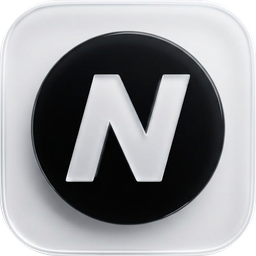
  </picture>

<h1 align="center">
  <picture>
    <source media="(prefers-color-scheme: dark)" srcset="assets/wordmark-dark.png">
    <source media="(prefers-color-scheme: light)" srcset="assets/wordmark-light.png">
    
  </picture>
</h1>

<b>Голосовой ИИ-ассистент для Windows</b>

  
  
  
  
  

<b>English</b> · click to read in English

 

Talk to your PC and it does the work: opens apps, switches windows, controls sound and music, looks at the screen, sets reminders and answers in a Jarvis voice.

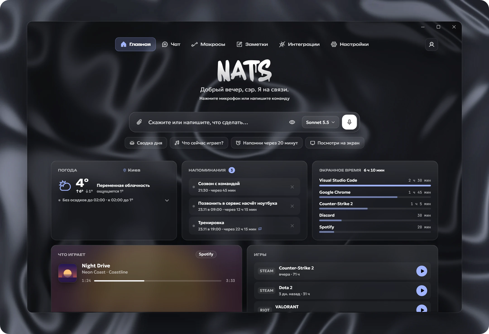

## What it is

NATS is a voice assistant for Windows 10 and 11. Say or type "turn the volume down", "open Downloads", "what is this error on my screen?", "remind me tomorrow at 9 to call the repair shop", and it does it on your computer instead of only replying with text.

Frequent commands (volume, player, apps, reminders, timers) are handled by NATS itself, with no neural network: they run in tens of milliseconds and keep working offline. Everything else, from questions to multi-step requests, goes to Claude by Anthropic. Claude comes with your key: you need no API key of your own, and there is no subscription.

The interface is in Russian. Commands work in Russian, Ukrainian and English.

## Features

### Say it or type it, and it gets done

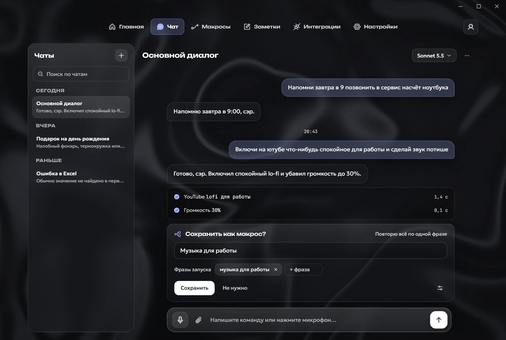

Under each answer you see what was done, step by step, with the time each step took. When a request repeats, NATS offers to save it as a macro: from then on one phrase runs it, without the neural network.

### Control the computer

| Area | What you can say or ask |
|---|---|
| Windows | "minimize everything", "switch to the browser", "move the window to the second monitor", "keep it on top", "leave only this one" |
| Sound | "volume 30", "Spotify quieter by 20", "switch sound to headphones", "switch the mic to the headset" |
| Music and video | pause, next track, "play something calm on YouTube", "find Radiohead" and then "play the second one"; full screen, subtitles and speed for a video in the browser |
| Apps and games | "launch Telegram", "launch CS": games from Steam, Epic Games, GOG, Ubisoft Connect, EA app, Battle.net and Riot, by nickname |
| Keyboard and text | types text into the open window, copies and pastes, fixes the keyboard layout of the selected text, changes case |
| Files | "find the report I downloaded yesterday", "what takes up space in Downloads", "open the budget presentation" |
| Windows settings | 41 pages of Settings, Bluetooth, Wi-Fi, Do Not Disturb, power plans, emptying the Recycle Bin |
| Power | lock, sleep, shut down or restart with a one-minute delay you can cancel |
| Network | local and external IP, Wi-Fi signal, ping, "does this site open" |
| Calculations | units, time in other cities, dates and ages, percentages, splitting a bill |

When there is no ready command, NATS clicks, types and scrolls in the app by itself while looking at the screen. To stop it, say "Stop" or move the mouse to the top-left corner of the screen. "Undo" brings back the volume, clipboard, player, a scheduled shutdown, a note or a reminder.

### Home screen and panels

The picture at the top of this page is the home screen. It holds up to nine panels: weather, reminders, screen time, Now Playing (album cover, seek bar and the volume of that particular player), games with a Play button, notes, quick commands, current tasks and system load. Panels can be hidden, folded, resized and moved.

### Macros as a node graph

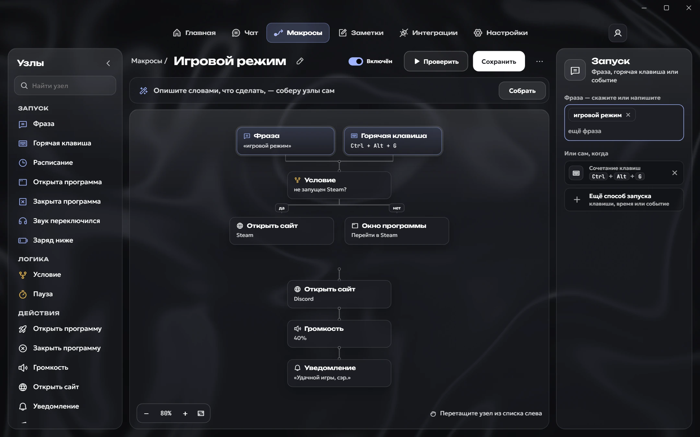

A macro is a chain of actions that starts from a phrase, a hotkey, a schedule or an event (an app started or closed, the sound output changed, the battery dropped below a level). Branches check the time of day, day of week, whether an app is running, where the sound goes, battery, an open window or a file. Build a macro from nodes, press "Show me" and let NATS record what you do and repeat it, or describe it in words and NATS assembles the nodes itself.

### Notes and reminders

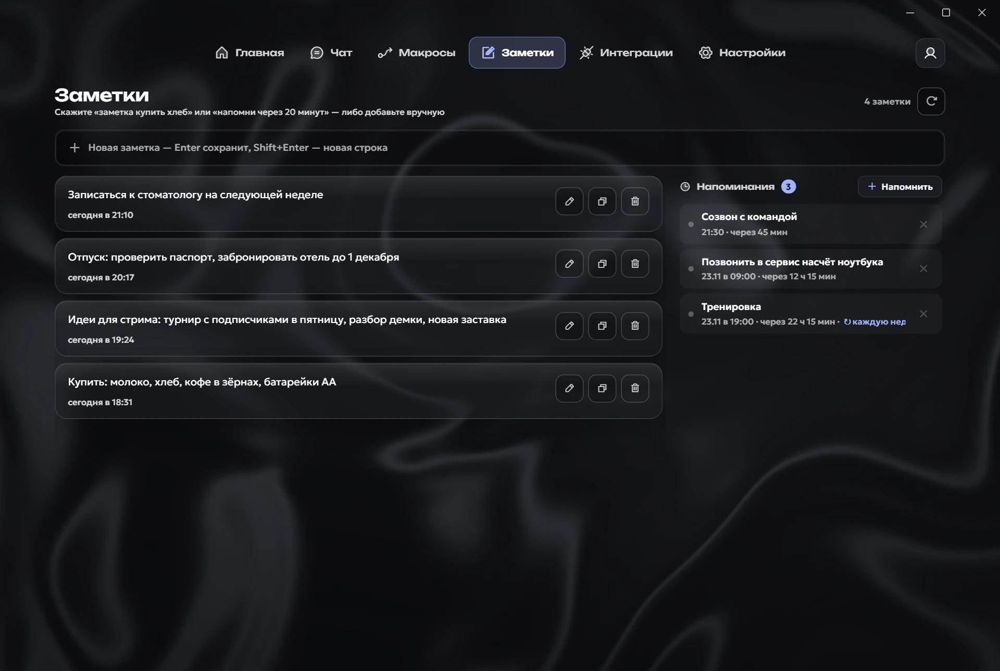

"Note: buy batteries", "add coffee to the shopping list", "delete the note about the dentist". Reminders for an exact time and repeating ones: "remind me on Friday at 6:30 pm", "remind me every day at 9". The app computes the time, not the model. "What do I have today" gives the day at a glance: weather, plans and the next reminder.

### Memory

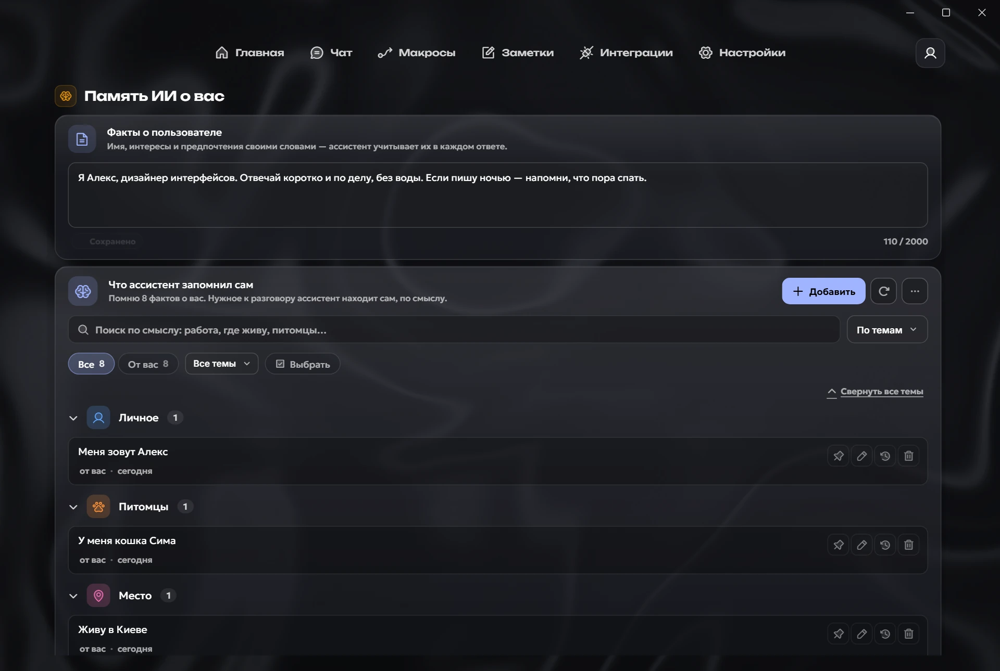

NATS remembers facts about you (name, city, work, tastes) and uses them in conversation. New facts don't erase old ones: "I moved to Lviv" marks the previous city as outdated. Everything is visible and editable in your profile, grouped by topic, with search by meaning. Passwords, codes and card numbers are never stored in memory.

### Claude models

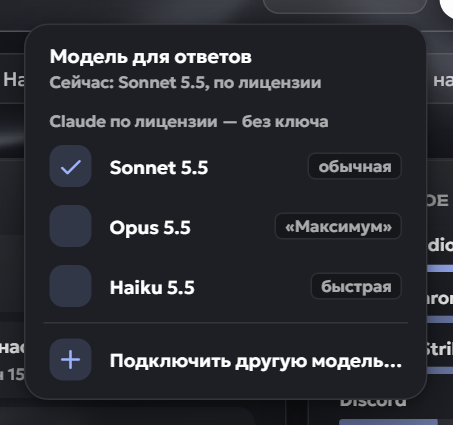

Your key gives you three Claude 5.5 models: Sonnet 5.5 for everyday answers, Opus 5.5 "Maximum" for careful thinking until the daily limit runs out, and Haiku 5.5 as the fastest. For things that change (exchange rates, news, match scores, prices) the model searches the web itself. You can also connect your own key: Anthropic, Gemini, OpenAI, Groq, OpenRouter, DeepSeek or a local Ollama.

### Voice

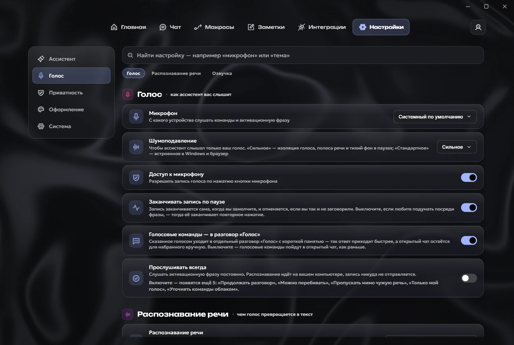

Speech is recognized on your computer (whisper.cpp) with a model picked for your graphics card and processor. NATS answers in a Jarvis voice and calls you "sir". Ctrl+Alt+Space speaks a command from any app, even while the window sits in the tray. You can turn on listening for its name; after an answer it keeps listening for 9 seconds, so a follow-up needs no name, and you can interrupt it by speaking.

### It sees the screen

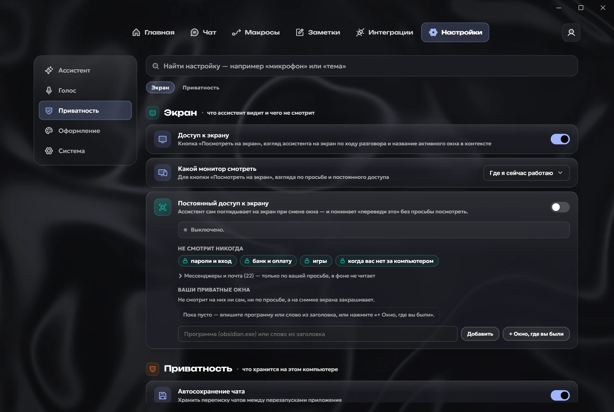

"Look at the screen, what is this error?" NATS takes a screenshot and answers from it. With Permanent access it glances at the screen by itself when you switch windows. It never looks at passwords, banking, sign-in or payment pages; it reads messengers and mail only when you ask; and it paints your private windows black on the screenshot.

### Appearance

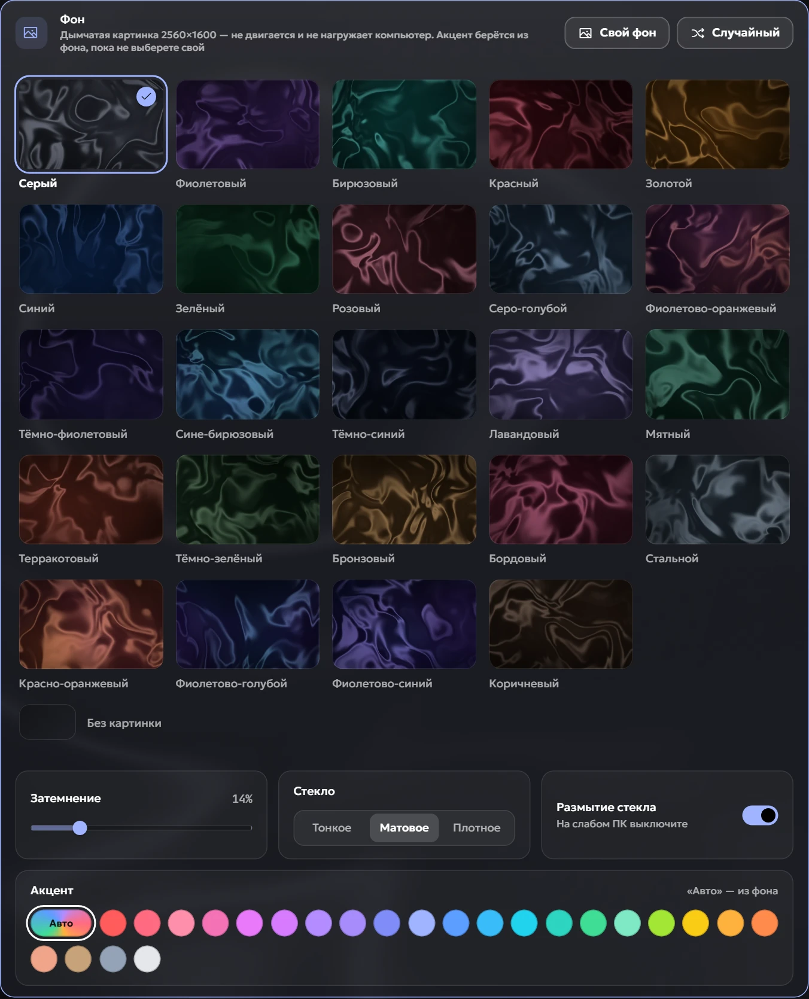

24 smoky backgrounds at 2560×1600 and 24 accent colors, plus dimming, glass density and blur. You can set your own picture. The background is still, so it doesn't load the computer.

### Integrations

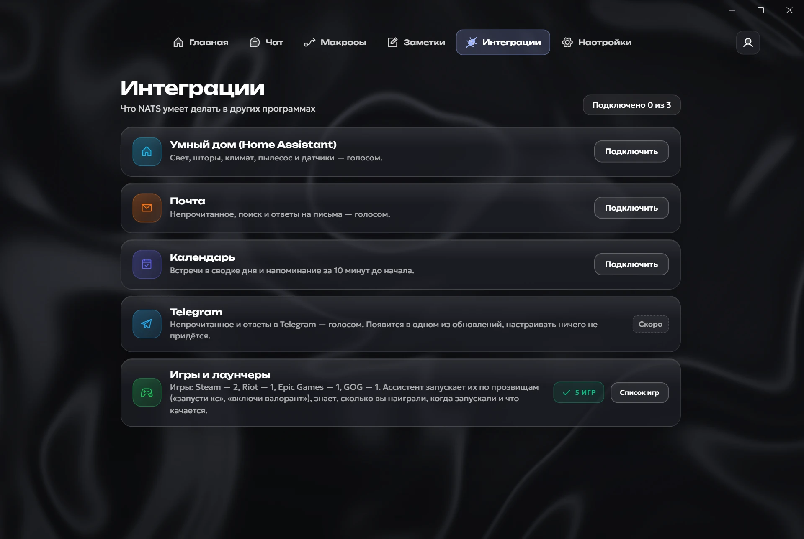

Smart home (Home Assistant), mail, calendar, games and launchers. Telegram is coming in one of the updates.

### More

- "Going to sleep": an alarm is set, music fades out, the smart-home lights go off, games close, and you get a summary of the day. The "Wake up" alarm wakes you gently with weather, plans and music that grows from quiet to normal.
- Focus mode: "focus for 25 minutes" mutes messengers and launchers, switches Windows notifications to alarms only and restores everything afterwards.
- Windows notifications: NATS reads them aloud and clears them.
- Moving to a new PC brings your chats, memory and macros along, through an encrypted cloud copy or a file.
- Updates download in the background and install when you close the app.

## Installation

1. Buy a key in the NATS SHOP Telegram bot, [@TheNuts_bot](https://t.me/TheNuts_bot) (the product is called NATS ULTRA). The key arrives in the chat right after payment.
2. Download the installer: **[NATS-ULTRA-Setup.exe](https://github.com/s1lenceyy/NATS-MAX-releases/releases/latest/download/NATS-ULTRA-Setup.exe)** (about 157 MB). All versions and release notes are on the [Releases](https://github.com/s1lenceyy/NATS-MAX-releases/releases) page.
3. Run it. If Windows shows "Windows protected your PC", click "More info" and then "Run anyway".
4. Pick a folder; the installer creates a desktop shortcut.
5. On first launch enter your name and key. With "Remember me" the key is stored encrypted and opens only in your Windows account.

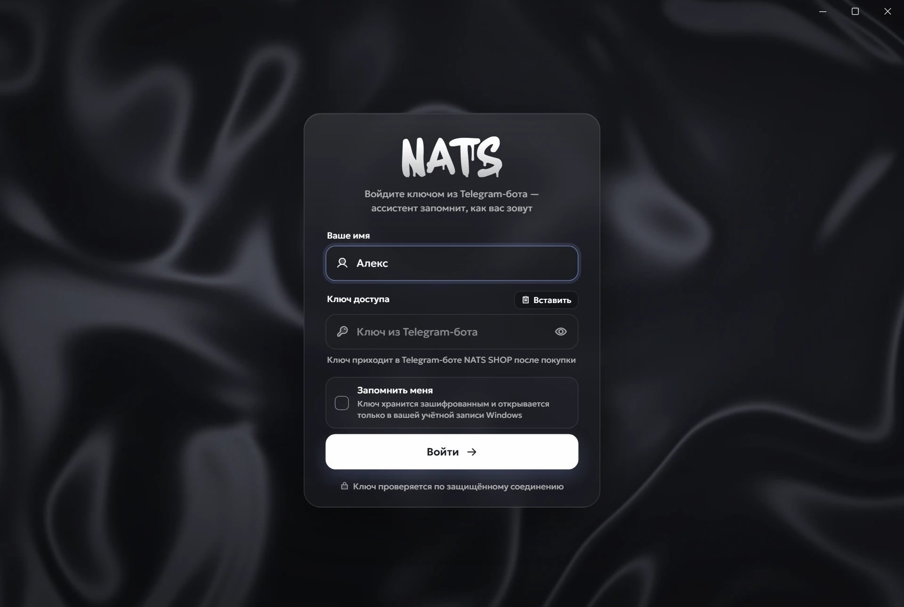

NATS downloads the speech model (from about 220 MB up to 1.6 GB depending on the hardware) by itself or offers it in Settings → Voice. To move the key to another PC, sign in there and press "Move the key here": up to 3 times in 30 days, no support ticket needed.

## System requirements

| Component | Requirement |
|---|---|
| System | Windows 10 or Windows 11, 64-bit |
| Disk | about 0.5 GB for the app, plus up to 2 GB for on-device speech recognition |
| Microphone | any; without one you can type |
| Internet | for Claude, the voice and the key check. Quick commands, on-device recognition, reminders and macros work offline |
| Graphics card | optional. NVIDIA (CUDA) or any card with Vulkan speeds up recognition; without one it runs on the CPU. On integrated graphics recognition needs at least 6 GB of RAM |

## Privacy

- Speech is recognized on your computer, and listening for the name works only there. In Auto mode a recording the PC could not recognize goes to the cloud (Gemini, through the NATS server); "On this computer only" never uses the cloud.
- Chats, notes, memory and macros are stored in a database on your computer.
- Questions to Claude and text for the voice go through the NATS server to Anthropic and Fish Audio. The server does not keep your conversations: its database holds only usage counters per key (requests and tokens per day). Answers to scheduled tasks wait on the server until the app picks them up and are deleted after a week.
- A screenshot goes to the model only when Screen access is on. NATS never looks at passwords, banking, sign-in and payment pages.
- Your NATS key and your own API keys are stored encrypted with Windows (DPAPI).
- About every 10 minutes the app tells the server that the key is in use on this computer, so one key can't run on several PCs at once.
- The cloud copy for moving to a new PC is encrypted on your computer; the server stores only the cipher and counts (how many facts and macros).
- A support report is sent only when you press the button, and you see all of it first. It holds the version, system, graphics card, speech recognition state and the core log, with no keys, passwords, chats, memory or notes.
- Turn on "Confirm actions" and NATS will ask Yes/No before commands, key presses, typing, closing windows and shutting down the PC.

## License

NATS is paid closed-source software. A key is bought once and has no expiry date; Claude, the voice and cloud recognition are included in the price within daily limits. One key works on one computer, and you can move it yourself up to 3 times in 30 days. This repository contains only installers and release notes.

© 2026 NATS. All rights reserved.

Third-party components: Electron (MIT), whisper.cpp (MIT), Phosphor Icons (MIT), agent-desktop (Apache 2.0), fonts Geologica, Inter, JetBrains Mono, Montserrat and Unbounded (SIL Open Font License 1.1).

## Help

- Something doesn't work: Settings → System → "Support report". Send it to the developer or save it as a file.
- Questions: the NATS SHOP Telegram bot, [@TheNuts_bot](https://t.me/TheNuts_bot).
- What's new: [latest release](https://github.com/s1lenceyy/NATS-MAX-releases/releases/latest).

<b>Русский</b>

 

Говорите с компьютером, и он делает: открывает программы, переключает окна, управляет звуком и музыкой, смотрит на экран, ставит напоминания и отвечает голосом Джарвиса.

## Что это

NATS — голосовой ассистент для Windows 10 и 11. Скажите или напишите «сделай звук потише», «открой загрузки», «что за ошибка у меня на экране?», «напомни завтра в 9 позвонить в сервис», и он сделает это на вашем компьютере, а не просто ответит текстом.

Частые команды (громкость, плеер, программы, напоминания, таймеры) NATS разбирает сам, без нейросети: они выполняются за десятки миллисекунд и работают без интернета. Всё остальное, от вопросов до просьб в несколько шагов, решает Claude от Anthropic. Claude входит в ключ: свой API-ключ не нужен, подписки нет.

Интерфейс на русском. Команды понимает на русском, украинском и английском.

## Возможности

### Скажите или напишите — он сделает

Под ответом видно, что именно сделано, по шагам и со временем каждого шага. Если просьба повторяется, NATS предложит сохранить её макросом: дальше она сработает по одной фразе и без нейросети.

### Управление компьютером

| Область | Что можно сказать или попросить |
|---|---|
| Окна | «сверни всё», «переключись на браузер», «окно на второй монитор», «поверх всех окон», «оставь только это» |
| Звук | «громкость 30», «спотифай тише на 20», «переключи звук на наушники», «переключи микрофон на гарнитуру» |
| Музыка и видео | пауза, следующий трек, «включи что-нибудь спокойное на ютубе», «найди Radiohead», а потом «включи второй»; у видео в браузере — полный экран, субтитры, скорость |
| Программы и игры | «запусти телеграм», «запусти кс»: игры из Steam, Epic Games, GOG, Ubisoft Connect, EA app, Battle.net и Riot, по прозвищам |
| Клавиатура и текст | печатает текст в открытое окно, копирует и вставляет, исправляет раскладку в выделенном («ghbdtn» → «привет»), меняет регистр |
| Файлы | «найди отчёт, который качал вчера», «что занимает место в загрузках», «открой презентацию про бюджет» |
| Windows | 41 страница «Параметров», Bluetooth, Wi-Fi, «Не беспокоить», схемы питания, очистка корзины |
| Питание | блокировка, сон, выключение и перезагрузка с отсрочкой в минуту, которую можно отменить |
| Сеть | локальный и внешний IP, сигнал Wi-Fi, пинг, «открывается ли сайт» |
| Расчёты | единицы, время в других городах, даты и возраст, проценты, счёт на компанию |

Если готовой команды нет, NATS сам нажимает, печатает и листает в программе, глядя на экран. Остановить — словом «Стоп» или мышью в левый верхний угол экрана. «Отмени» возвращает громкость, буфер обмена, плеер, отложенное выключение, заметку или напоминание.

### Главная и панели

Главная — на картинке в начале страницы. На ней до девяти панелей: погода, напоминания, экранное время, «Что играет» (обложка, перемотка и громкость именно этого плеера), игры с кнопкой «Играть», заметки, быстрые команды, текущие задачи и нагрузка компьютера. Панели можно скрыть, свернуть, сделать крупнее или мельче и переставить.

### Макросы схемой узлов

Макрос — цепочка действий, которая запускается фразой, сочетанием клавиш, по расписанию или по событию: открылась или закрылась программа, переключился звук, заряд упал ниже порога. Ветки «если — иначе» проверяют время суток, день недели, запущена ли программа, куда идёт звук, заряд, открытое окно или файл. Макрос можно собрать из узлов, нажать «Показать», чтобы NATS записал ваши действия и повторил их, или описать словами, и он соберёт узлы сам.

### Заметки и напоминания

«Заметка: купить батарейки», «допиши в список покупок кофе», «удали заметку про стоматолога». Напоминания на точное время и повторяющиеся: «напомни в пятницу в 18:30», «напоминай каждый день в 9». Время считает программа, а не нейросеть. «Что у меня сегодня» — сводка дня: погода, дела и ближайшее напоминание.

### Память

NATS запоминает факты о вас — имя, город, работу, вкусы — и учитывает их в разговоре. Новое не затирает старое: «я переехал во Львов» пометит прежний город устаревшим. Всё видно и правится в профиле: по темам и с поиском по смыслу. Пароли, коды и номера карт в память не попадают.

### Модели Claude

По ключу доступны три модели Claude 5.5: Sonnet 5.5 — для обычных ответов, Opus 5.5 «Максимум» — подумать как следует, пока не кончится дневной предел, Haiku 5.5 — самая быстрая. То, что меняется (курс валют, новости, счёт матча, цены), модель сама ищет в интернете. Можно подключить и свой ключ: Anthropic, Gemini, OpenAI, Groq, OpenRouter, DeepSeek или локальную Ollama.

### Голос

Речь распознаётся на вашем компьютере (whisper.cpp), модель подбирается под видеокарту и процессор. Отвечает NATS голосом Джарвиса и обращается к вам «сэр». Ctrl+Alt+Пробел — сказать команду из любой программы, даже когда окно свёрнуто в трей. Можно включить прослушивание по имени; после ответа он ещё 9 секунд слушает продолжение без обращения по имени, а перебить его можно голосом.

### Видит экран

«Посмотри на экран — что за ошибка?» NATS делает снимок и отвечает по нему. С «Постоянным доступом» он сам поглядывает на экран при смене окна. Пароли, банк, вход и оплату не смотрит никогда; мессенджеры и почту — только по вашей просьбе; ваши приватные окна закрашивает на снимке.

### Оформление

24 дымчатых фона 2560×1600 и 24 цвета акцента, а ещё затемнение, плотность стекла и размытие. Можно поставить свою картинку. Фон неподвижный и не нагружает компьютер.

### Интеграции

Умный дом (Home Assistant), почта, календарь, игры и лаунчеры. Telegram появится в одном из обновлений.

### Ещё

- «Ложусь спать»: будильник заведён, музыка стихает, свет умного дома гаснет, игры закрываются, и вы слышите итог дня. Будильник «Подъём» будит мягко: погода, дела и музыка от тихой к обычной.
- Режим фокуса: «включи фокус на 25 минут» приглушает мессенджеры и лаунчеры, переводит уведомления Windows в «только будильники» и потом возвращает всё как было.
- Уведомления Windows: NATS прочитает их вслух и уберёт.
- Переезд на новый компьютер вместе с чатами, памятью и макросами: зашифрованной облачной копией или файлом.
- Обновления скачиваются в фоне и ставятся, когда вы закрываете программу.

## Установка

1. Купите ключ в Telegram-боте NATS SHOP — [@TheNuts_bot](https://t.me/TheNuts_bot) (товар называется NATS ULTRA). Ключ придёт в чат сразу после оплаты.
2. Скачайте установщик: **[NATS-ULTRA-Setup.exe](https://github.com/s1lenceyy/NATS-MAX-releases/releases/latest/download/NATS-ULTRA-Setup.exe)** (около 157 МБ). Все версии и что в них нового — на странице [Releases](https://github.com/s1lenceyy/NATS-MAX-releases/releases).
3. Запустите его. Если Windows покажет «Система Windows защитила ваш компьютер», нажмите «Подробнее», затем «Выполнить в любом случае».
4. Выберите папку; установщик создаст ярлык на рабочем столе.
5. При первом запуске введите имя и ключ. С «Запомнить меня» ключ хранится зашифрованным и открывается только в вашей учётной записи Windows.

Модель распознавания речи (от ~220 МБ до 1,6 ГБ, смотря по железу) NATS скачает сам или предложит в «Настройки → Голос». Чтобы перенести ключ на другой компьютер, войдите на нём и нажмите «Перенести ключ сюда»: до 3 раз за 30 дней, без обращения в поддержку.

## Системные требования

| Что нужно | Требование |
|---|---|
| Система | Windows 10 или Windows 11, 64-бит |
| Место на диске | около 0,5 ГБ на программу и до 2 ГБ на распознавание речи на компьютере |
| Микрофон | любой; без него можно писать |
| Интернет | для Claude, голоса и проверки ключа. Быстрые команды, распознавание на компьютере, напоминания и макросы работают и без сети |
| Видеокарта | не обязательна. NVIDIA (CUDA) или любая с Vulkan ускоряет распознавание, без неё оно идёт на процессоре. На встроенной видеокарте распознаванию нужно от 6 ГБ оперативной памяти |

## Конфиденциальность

- Речь распознаётся на вашем компьютере, прослушивание по имени работает только на нём. В режиме «Авто» запись, которую компьютер не разобрал, уходит в облако (Gemini через сервер NATS); режим «Только на этом компьютере» облака не трогает.
- Переписка, заметки, память и макросы хранятся в базе на вашем компьютере.
- Вопросы к Claude и текст для озвучки идут через сервер NATS к Anthropic и Fish Audio. Переписку сервер не хранит: в его базе только счётчики расхода по ключу — сколько запросов и токенов за день. Ответы отложенных поручений ждут на сервере, пока программа их заберёт, и удаляются через неделю.
- Снимок экрана уходит модели, только когда включён «Доступ к экрану». Пароли, банк, страницы входа и оплаты NATS не смотрит никогда.
- Ключ NATS и ваши собственные API-ключи хранятся зашифрованными средствами Windows (DPAPI).
- Примерно раз в 10 минут программа сообщает серверу, что ключ работает на этом компьютере, — так один ключ не работает на нескольких ПК сразу.
- Облачная копия для переезда шифруется на вашем компьютере; сервер хранит только шифр и числа (сколько фактов и макросов).
- Отчёт для поддержки уходит только по вашей кнопке, и вы видите его целиком до отправки. В нём версия, система, видеокарта, состояние распознавания речи и журнал ядра; ключей, паролей, переписки, памяти и заметок в нём нет.
- Включите «Подтверждать действия», и перед командами, нажатием клавиш, печатью, закрытием окон и выключением ПК NATS спросит «Да/Нет».

## Лицензия

NATS — платная программа с закрытым кодом. Ключ покупается один раз и действует без срока; Claude, голос и облачное распознавание входят в цену в пределах дневных лимитов. Один ключ работает на одном компьютере, перенести его можно самостоятельно до 3 раз за 30 дней. В этом репозитории только установщики и описания выпусков.

© 2026 NATS. Все права защищены.

Сторонние компоненты: Electron (MIT), whisper.cpp (MIT), Phosphor Icons (MIT), agent-desktop (Apache 2.0), шрифты Geologica, Inter, JetBrains Mono, Montserrat и Unbounded (SIL Open Font License 1.1).

## Помощь

- Что-то не работает: «Настройки → Система → Отчёт для поддержки». Отправьте его разработчику или сохраните файлом.
- Вопросы — в Telegram-боте NATS SHOP: [@TheNuts_bot](https://t.me/TheNuts_bot).
- Что нового — в [последнем выпуске](https://github.com/s1lenceyy/NATS-MAX-releases/releases/latest).

